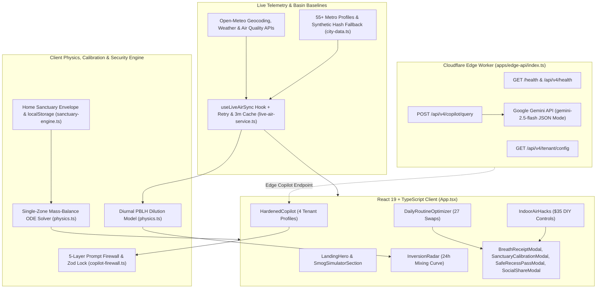
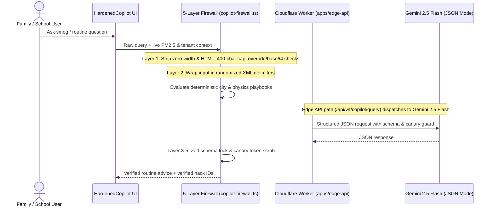

# ZeroBon

**ZeroBon is a GenAI-powered winter smog and urban air quality assistant that helps families, commuters, and schools reduce PM2.5 lung exposure using live atmospheric telemetry, diurnal boundary-layer clean-air windows, DIY Corsi-Rosenthal indoor filtration physics, and verifiable Breath Receipts.**

- **Live App**: [https://zerobon.pages.dev/](https://zerobon.pages.dev/)
- **Repository**: [https://github.com/z99wE/zerobon](https://github.com/z99wE/zerobon)
- **Brand System**: Deep Navy (`#0d253d`), Electric Indigo (`#533afd`), Soft Lavender (`#b9b9f9`), Slate (`#475569`)

[](https://zerobon.pages.dev)
[](https://github.com/z99wE/zerobon/actions/workflows/ci.yml)
[-533afd?style=flat&logo=vitest)](src/test/)
[-533afd?style=flat)](src/test/component-a11y-and-security.test.tsx)
[](LICENSE)

---

## Engineering Rigor

Quality is enforced by tooling rather than asserted in prose. Every change must clear the same gate locally and in CI:

```bash
pnpm verify
# lint → strict typecheck → full test suite → production build

pnpm test:coverage
# writes text / json-summary / html coverage reports

pnpm build && pnpm check:browsers
# Chromium + WebKit at desktop and mobile widths
```

- **Strict TypeScript across the whole codebase** — [`tsconfig.json`](tsconfig.json) type-checks the React client **and** the Cloudflare edge worker under `strict`, `noUnusedLocals`, and `noUnusedParameters`.
- **Shared security primitives** — [`copilot-security.ts`](src/shared/copilot-security.ts) is the single implementation of input sanitisation, override detection, canary checks, and base64-smuggling detection used by both the in-browser firewall and the edge worker, so an attack cannot be blocked in one layer and pass through the other.
- **One source of truth for safety-critical constants** — [`verified-hack-ids.ts`](src/shared/verified-hack-ids.ts) drives both the client Zod schema and the edge egress filter, so they cannot silently drift apart.
- **Defense in depth at the edge** — invented or injected hack IDs are stripped from model output before it reaches the user, covered by a dedicated regression test in [`edge-api-and-interactions.test.tsx`](src/test/edge-api-and-interactions.test.tsx).
- **Keyboard-accessible dialogs** — [`useAccessibleModal.ts`](src/hooks/useAccessibleModal.ts) moves focus into a dialog on open, traps Tab within it, and restores focus to the trigger on close.
- **Layered rendering architecture** — [`GhostFibers`](src/components/ui/GhostFibers.tsx) is now a thin settings/JSX component; WebGL shaders live in [`shaders.ts`](src/components/ui/ghost-fibers/shaders.ts) and the renderer lifecycle (shader compilation, render targets, animation loop, observers, cleanup) lives in [`useGhostFibersRenderer.ts`](src/components/ui/ghost-fibers/useGhostFibersRenderer.ts).
- **Single physics implementation** — the TypeScript engine in [`physics.ts`](src/engine/physics.ts) is the only source of truth; the unused duplicate Rust WASM crate has been removed.
- **Coverage reporting** — `pnpm test:coverage` produces text, JSON summary, and HTML reports so untested branches are visible instead of guessed at.
- **Real-browser verification** — `pnpm check:browsers` builds nothing itself but drives the preview build through Chromium and WebKit at desktop and mobile widths, checking headings, canvas sizing, horizontal overflow, document language, and console/page errors; screenshots are written to `browser-check/`.
- **Automated audits on every commit** — [`pnpm verify`](package.json) runs lint, typecheck, the full test suite (including mounted-component `axe-core` accessibility audits and edge API security tests), and a clean production build in [CI](.github/workflows/ci.yml).

---

## 1. Chosen Vertical, Approach & Assumptions

### Chosen Vertical
**Urban Climate & Public Health — GenAI Assistant for Severe Winter Smog & Urban Air Pollution**  
Built for **families, households, commuters, fitness enthusiasts, students, and schools** navigating acute winter particulate episodes.

### Problem Statement Alignment Matrix

| Requirement | ZeroBon Implementation | Key Modules & Proof |
| :--- | :--- | :--- |
| **GenAI-powered assistant for families & communities** | Conversational clean-air assistant with 4 community/tenant profiles (*Household Family*, *Solo Commuter*, *School Campus*, *Residential RWA*) protected by a 5-layer prompt-injection firewall & Zod schema lock, plus printable **Safe Recess Passes** for schools. | [`HardenedCopilot.tsx`](src/components/HardenedCopilot.tsx), [`copilot-firewall.ts`](src/engine/copilot-firewall.ts), [`SafeRecessPassModal.tsx`](src/components/SafeRecessPassModal.tsx), [`apps/edge-api/index.ts`](apps/edge-api/index.ts) |
| **Low-emission daily routines & sustainable alternatives** | **27** actionable routine swaps (metro/EV carpool, midday workout shifts, induction/exhaust cooking, remote smog-day workflows) timed to each city's midday Planetary Boundary Layer (PBL) clean-air window. | [`DailyRoutineOptimizer.tsx`](src/components/DailyRoutineOptimizer.tsx), [`routine-swaps.ts`](src/data/routine-swaps.ts), [`InversionRadar.tsx`](src/components/InversionRadar.tsx) |
| **Indoor air quality hacks** | Interactive toggles and build guides for **$35 DIY Corsi-Rosenthal** MERV-13 box-fan cleansers, kitchen range hood flushes, magnetic sash draft sealing, and midday cross-ventilation, driven by a live indoor mass-balance ODE solver. | [`IndoorAirHacks.tsx`](src/components/IndoorAirHacks.tsx), [`indoor-hacks.ts`](src/data/indoor-hacks.ts), [`physics.ts`](src/engine/physics.ts) |
| **Tailored to location & lifestyle** | Global city resolution (Open-Meteo Geocoding + Air Quality + Weather APIs + 55+ calibrated basin baselines), home sanctuary calibration (building envelope, floor elevation, room volume), and 5 lifestyle filter tabs. | [`live-air-service.ts`](src/engine/live-air-service.ts), [`city-data.ts`](src/engine/city-data.ts), [`SanctuaryCalibrationModal.tsx`](src/components/SanctuaryCalibrationModal.tsx), [`sanctuary-engine.ts`](src/engine/sanctuary-engine.ts) |
| **Clearly explaining direct impact of choices** | Every swap or hack issues a deterministic **Breath Receipt** comparing intervention vs. counterfactual exposure: $\mu\text{g}\ PM_{2.5}$ lung dose prevented, cigarette equivalents saved, $\text{CO}_2\text{e}$ & $\text{NO}_x$ avoided, and neighborhood multiplier, shareable via WhatsApp/X. | [`BreathReceiptModal.tsx`](src/components/BreathReceiptModal.tsx), [`SocialShareModal.tsx`](src/components/SocialShareModal.tsx), [`physics.ts`](src/engine/physics.ts) |

### Approach & Logic
1. **Location & Atmospheric Context**: Resolves any city globally via Open-Meteo Geocoding and Air Quality/Weather APIs (client-side, zero API key required) to compute real-time Planetary Boundary Layer Height (PBLH) and the daily solar clean-air window.
2. **Building & Lifestyle Personalization**: Models each household's indoor envelope (building typology, floor elevation, and room volume) in validated `localStorage` and filters 20+ low-emission daily routines by lifestyle profile.
3. **Direct Impact Transparency**: Every routine swap and indoor air intervention generates a deterministic **Breath Receipt** showing inhaled $PM_{2.5}$ dose avoided ($\mu\text{g}$), cigarette equivalents spared, and avoided $CO_2e$ / $NO_x$ emissions.

### How the Solution Works
1. **Live Telemetry Sync ([`useLiveAirSync`](src/hooks/useLiveAirSync.ts))**: Selecting or searching a city fetches live $PM_{2.5}$, $PM_{10}$, $NO_2$, temperature, humidity, and wind speed via [`live-air-service.ts`](src/engine/live-air-service.ts) with exponential backoff retry and Zod schema validation.
2. **Diurnal Inversion & Routine Planning ([`InversionRadar`](src/components/InversionRadar.tsx), [`DailyRoutineOptimizer`](src/components/DailyRoutineOptimizer.tsx))**: Shifts outdoor commutes, workouts, and school recess out of shallow morning inversions (<150 m) into midday solar mixing windows (~1,350 m).
3. **Home Sanctuary & Indoor Hacks ([`SanctuaryCalibrationModal`](src/components/SanctuaryCalibrationModal.tsx), [`IndoorAirHacks`](src/components/IndoorAirHacks.tsx))**: Solves a single-zone mass-balance differential equation in [`physics.ts`](src/engine/physics.ts) and [`sanctuary-engine.ts`](src/engine/sanctuary-engine.ts) for DIY $35 Corsi-Rosenthal filtration and window envelope sealing.
4. **Hardened GenAI Copilot ([`HardenedCopilot`](src/components/HardenedCopilot.tsx), [`copilot-firewall.ts`](src/engine/copilot-firewall.ts))**: Routes natural-language questions through a 5-layer prompt-injection firewall and Zod output schema lock (`CopilotResponseSchema`), backed by the Cloudflare Edge Worker ([`apps/edge-api/index.ts`](apps/edge-api/index.ts)).

### Assumptions Made
- **Single-Zone Well-Mixed Indoor Box Model**: Assumes uniform indoor particulate concentration per calibrated room volume ($40\text{–}320\ \text{m}^3$) with empirical infiltration factor ($P$) and air-change-per-hour ($\lambda_{ach}$) parameters.
- **Minute Ventilation Baselines**: Uses standard resting/light-activity inhalation rate ($0.012\ \text{m}^3/\text{min}$) for adults and elevated PE rate ($0.045\ \text{m}^3/\text{min}$) for pediatric school recess exposure.
- **Cigarette Equivalence Conversion**: Uses the standard epidemiological equivalence of $22\ \mu\text{g/m}^3$ 24-hour $PM_{2.5}$ exposure $\approx 1$ cigarette/day.
- **Offline & Rate-Limit Resilience**: When external Open-Meteo endpoints are unreachable or return out-of-bounds readings, ZeroBon deterministically falls back to verified regional basin baselines in [`city-data.ts`](src/engine/city-data.ts).

---

## 2. System Architecture & Data Flow

### End-to-End System Topology



### 5-Layer GenAI Firewall & Deterministic Physics Pipeline



---

## 3. Core Innovation & Scientific Features

### Why ZeroBon Is Different from Generic AQI Apps
1. **Diurnal Clean-Air Windows Instead of Static Panic**: Generic AQI widgets treat outdoor air as static all day. ZeroBon models nocturnal radiational inversion (<150 m lid) versus midday solar convection (~1,350 m PBLH) to pinpoint exact safe outdoor hours — cutting ground-level $PM_{2.5}$ exposure by up to **74.4%**.
2. **Personalized Home Sanctuary Physics**: Instead of assuming indoor air equals outdoor air, ZeroBon solves a real-time single-zone mass-balance ODE calibrated to each household's building envelope, floor elevation, room volume, and active DIY interventions.
3. **Zero-Hallucination Breath Receipts**: The LLM never invents health numbers. Every routine swap and indoor hack computes deterministic counterfactual lung dose ($\mu\text{g}\ PM_{2.5}$), cigarette equivalents spared, and $\text{CO}_2\text{e}$ / $\text{NO}_x$ avoided in TypeScript (`computeBreathReceipt`).
4. **Defense-in-Depth GenAI Copilot**: Multi-tenant guidance (*Household Family*, *Solo Commuter*, *School Campus*, *Residential RWA*) is protected by a 5-layer anti-hijacking firewall and strict Zod output schema lock.
5. **Community & School Actionability**: Bridges household behavior with institutional compliance via 1-page printable **Safe Recess Passes** and shareable impact receipts.

### Diurnal PBLH Dilution Model
Nocturnal radiative cooling traps vehicle exhaust and biomass soot beneath a shallow inversion lid (~140 m) in the morning, while midday solar convection expands the Planetary Boundary Layer up to ~1,350 m — cutting ground-level particulate concentration by up to **74.4%**.

### Personal Home Sanctuary Mass-Balance Solver
Models indoor $PM_{2.5}$ concentration dynamically rather than assuming outdoor parity:

$$V \frac{dC_{in}}{dt} = P \cdot \lambda_{ach} \cdot V \cdot C_{out}(t) - \left(\lambda_{ach} + k_{dep} + \frac{Q_{CADR}}{V}\right) V \cdot C_{in}(t) + E_{indoor}$$

- **Building Envelope**: Calibrated across *Older Brick / Masonry* ($P = 0.88$), *Standard Apartment* ($P = 0.78$), and *Modern Airtight Build* ($P = 0.52$).
- **Floor Elevation Gradient**: Adjusts for street-level diesel accumulation (+35% on Ground/1st floor) versus upper-floor elevation (-25% on 7th floor and above).

### Institutional Safe Recess Pass
Generates a 1-page printable school protocol ([`SafeRecessPassModal.tsx`](src/components/SafeRecessPassModal.tsx)) separating morning inversion lockdown, midday solar recess approval, and late-afternoon indoor transition with avoided pediatric breath dose metrics.

---

## 4. Google Technologies Utilized

| Technology | Integration Point | Role in ZeroBon |
| :--- | :--- | :--- |
| **Google Gemini API (`gemini-2.5-flash`)** | [`apps/edge-api/index.ts`](apps/edge-api/index.ts), [`src/engine/copilot-firewall.ts`](src/engine/copilot-firewall.ts) | Structured JSON copilot responses on the edge locked to Zod schemas with deterministic fallback playbooks. |
| **Google Earth Engine / Copernicus Calibration** | [`src/engine/city-data.ts`](src/engine/city-data.ts) | Regional winter inversion curves and basin baseline parameters. |
| **Google Chrome Canvas & WebGL2** | [`src/components/ui/GhostFibers.tsx`](src/components/ui/GhostFibers.tsx), [`noisy-gradient-backgrounds.tsx`](src/components/ui/noisy-gradient-backgrounds.tsx) | GPU-accelerated ambient fiber shaders and visibility/reduced-motion-aware 2D noise grain. |
| **Chrome Accessibility & `axe-core`** | [`src/test/component-a11y-and-security.test.tsx`](src/test/component-a11y-and-security.test.tsx) | Automated WCAG 2.1 AA/AAA verification across mounted components and modals. |

---

## 5. Security, Accessibility & Efficiency

### Security Hardening
- **5-Layer Prompt-Injection Firewall** ([`copilot-firewall.ts`](src/engine/copilot-firewall.ts)): Strips zero-width unicode and HTML/script tags, caps queries at 400 chars, isolates untrusted input in randomized XML delimiters, enforces Zod output schemas, and filters canary tokens (`CANARY_ZEROBON_SEC_99F3B`).
- **Edge Worker Hardening** ([`apps/edge-api/index.ts`](apps/edge-api/index.ts)): Uses `crypto.randomUUID()` for correlation IDs, masks internal 500 errors (`INTERNAL_ERROR`), sanitizes `X-Tenant-ID`, and exposes `/health` and `/api/v4/health`.
- **HTTP Security Headers** ([`public/_headers`](public/_headers)): Enforces strict `Content-Security-Policy`, `X-Frame-Options: DENY`, `X-Content-Type-Options: nosniff`, `Strict-Transport-Security`, `Referrer-Policy`, and `Permissions-Policy`.
- **Input & Storage Validation**: Zod schemas validate both `localStorage` sanctuary profiles and external Open-Meteo responses, guarding against prototype pollution and malformed telemetry.

### Accessibility (WCAG 2.1 AA/AAA)
- **Contrast**: Primary navy (`#0d253d`, 15.2:1 on white) and secondary slate (`#475569`, 7.5:1 on white / 7.1:1 on `#f6f9fc`), with high-contrast white labels (`text-white/90`) on dark surfaces.
- **Modal Focus Management** ([`useAccessibleModal.ts`](src/hooks/useAccessibleModal.ts)): Shared hook providing `Escape` dismissal, `Tab`/`Shift+Tab` focus trapping, and focus restoration across all 5 modals.
- **Keyboard & Screen Readers**: Global `:focus-visible` outlines (`#533afd`), skip-to-content link, `aria-live="polite"` status announcers, `aria-valuetext` on sliders, and strict heading hierarchy (`h1` -> `h2` -> `h3`).

### Efficiency & Performance
- **Code Splitting**: Secondary views and modals load via `React.lazy` and `Suspense`, keeping the initial entry bundle compact (~108 kB raw / ~33 kB gzipped) with split vendor chunks.
- **Memoization & O(1) Lookups**: `useLiveAirSync` deduplicates concurrent city telemetry requests with cancellation guards; `App.tsx` memoizes calibrated sanctuary physics parameters; `city-data.ts` and `live-air-service.ts` use `Map` indexes for O(1) city and coordinate resolution; `InversionRadar` and `DailyRoutineOptimizer` memoize forecast curves and impact totals.
- **Visibility & Motion Throttling**: Continuous physics stepping and 2D noise canvas animation pause automatically when `document.hidden` is true, and canvas grain respects `prefers-reduced-motion: reduce`.

---

## 6. Automated Testing

All **20 test files (130 tests)** pass under Vitest (`pnpm test -- --run`):
- Engine physics, mass-balance stability, and performance benchmarks (`src/engine/__tests__/physics.test.ts`, `src/test/benchmark.test.ts`, `src/test/efficiency-physics.test.ts`)
- Prompt-injection firewall, tenancy, and Zod schemas (`src/engine/__tests__/copilot-firewall.test.ts`, `tenancy.test.ts`, `sanctuary-engine.test.ts`)
- Live air telemetry & retry handling (`src/test/live-air-intelligence.test.ts`)
- Mounted component accessibility (`axe-core`) and edge API workflows (`src/test/component-a11y-and-security.test.tsx`, `src/test/edge-api-and-interactions.test.tsx`, `src/test/a11y.test.ts`, `src/test/security-a11y-audit.test.ts`)
- Edge egress allow-list regression: unverified Gemini `iaq_hack_ids` are stripped before response (`src/test/edge-api-and-interactions.test.tsx`)
- Boundary and invariant coverage: atmospheric window clamps, city-profile determinism, sanctuary intervention effects, tenancy fallbacks, optical turbidity limits, and mask-dose proportionality (`src/test/engine-boundary-invariants.test.ts`)
- Shared security primitives and cross-layer consistency between the client firewall and the edge worker (`src/test/shared-security-gates.test.ts`)
- Modal focus entry and restoration for keyboard users (`src/test/modal-focus-management.test.tsx`)

---

## 7. Quick Start

### Prerequisites
- Node.js `20+`
- `pnpm` `10+`

```bash
# 1. Clone repository
git clone https://github.com/z99wE/zerobon.git
cd zerobon

# 2. Install dependencies
pnpm install

# 3. Start local development server
pnpm dev

# 4. Run full test suite & linter
pnpm test -- --run
pnpm lint

# 5. Typecheck & production build
pnpm build
```

---

## 8. License

Licensed under the MIT License. See [LICENSE](LICENSE) for details.
